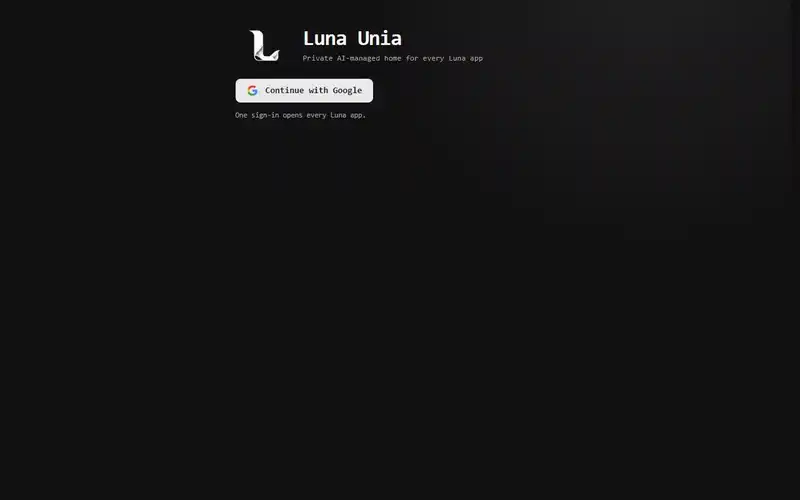
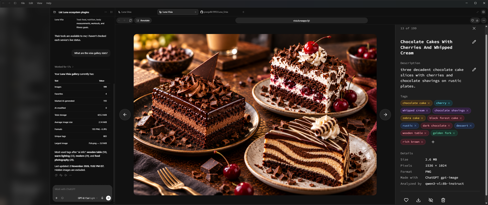

# Luna Visia


**A private image library that describes every picture for you.** A local vision model captions and tags each
upload, so you and your AI assistant can find, organize and edit images by what is in them, without opening each one.

<p align="center">
  <a href="docs/assets/luna-visia-showcase.mp4"></a>
</p>

<p align="center"><em>Searching and browsing the gallery, then an assistant finding images by meaning and handing
back a ZIP. Select it for the sharper video.</em></p>

## What it does

- **Describes every upload:** a caption and searchable tags from a local vision model, plus a check for AI-generated
  or AI-edited images.
- **Search by words or meaning:** filenames, captions and tags, or what an image looks like (SigLIP 2 embeddings).
- **Browse:** 3:2 thumbnails, full-size view, and sorting by relevance, date, name or size.
- **Work on many at once:** select images to favourite, hide, download as a ZIP, delete, or fix their tags and
  descriptions together.
- **Hidden images** behind your hidden-items PIN, kept out of every gallery, search and tool.
- **Favourites** for the images you return to.

<p align="center">
  
</p>

## Quickstart

Visia runs on [Luna Sentia](https://github.com/pranjallk1995/Luna_Sentia), which provides its database, vision model
and sign-in. On one machine you need no `.env`:

```sh
git clone https://github.com/pranjallk1995/Luna_Sentia.git
git clone https://github.com/pranjallk1995/Luna_Visia.git
./Luna_Sentia/luna.sh start visia
```

Open <http://localhost:18505> and sign in as Sentia's owner. Before giving Visia a public address, set your own
secrets: see [Getting started](https://github.com/pranjallk1995/Luna_Visia/wiki/Getting-Started).

## Connect your AI assistant

Add `https://<your visia MCP host>/mcp` to Claude, ChatGPT or any MCP client as a custom connector (OAuth). The
assistant can search the library, show previews, rename, retag, replace or bundle images. Every tool is listed in
[MCP tools](https://github.com/pranjallk1995/Luna_Visia/wiki/MCP-Tools).

## Works with

Other Luna apps keep their pictures here, tagged with the app's name: food photos for
[Luna Vita](https://github.com/pranjallk1995/Luna_Vita), cover art for
[Luna Vibia](https://github.com/pranjallk1995/Luna_Vibia), and room and light pictures for
[Luna Lumia](https://github.com/pranjallk1995/Luna_Lumia). They store them with the private
`LUNAVISIA_COMPANION_TOKEN`; see [Getting started](https://github.com/pranjallk1995/Luna_Visia/wiki/Getting-Started).

## Documentation

The [wiki](https://github.com/pranjallk1995/Luna_Visia/wiki) has the full reference:

| Page | What's in it |
| --- | --- |
| [Home](https://github.com/pranjallk1995/Luna_Visia/wiki) | Every feature in detail |
| [Getting started](https://github.com/pranjallk1995/Luna_Visia/wiki/Getting-Started) | Setup, `.env`, sign-in, other apps' images |
| [MCP tools](https://github.com/pranjallk1995/Luna_Visia/wiki/MCP-Tools) | Every tool your assistant can call |
| [Architecture](https://github.com/pranjallk1995/Luna_Visia/wiki/Architecture) | Services, the vision model, metadata and search, data model and database diagram |
| [Development](https://github.com/pranjallk1995/Luna_Visia/wiki/Development) | Project structure, modules, tests |
| [Operations](https://github.com/pranjallk1995/Luna_Visia/wiki/Operations) | The database UI |

The UI follows [UI_STYLE_GUIDE.md](UI_STYLE_GUIDE.md).

## Releases and development

Releases are on the [Releases page](https://github.com/pranjallk1995/Luna_Visia/releases). To update: `git pull`, then
`./Luna_Sentia/luna.sh start visia`. To run your local code and reload it as you edit:
`./Luna_Sentia/luna.sh start --build --watch visia`.
