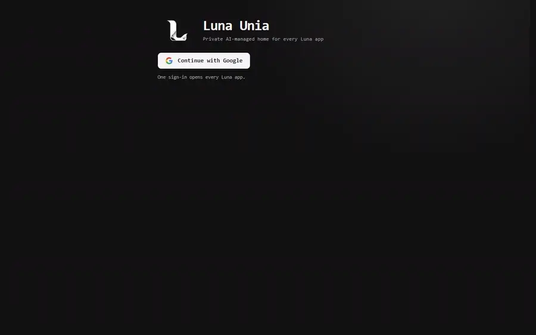
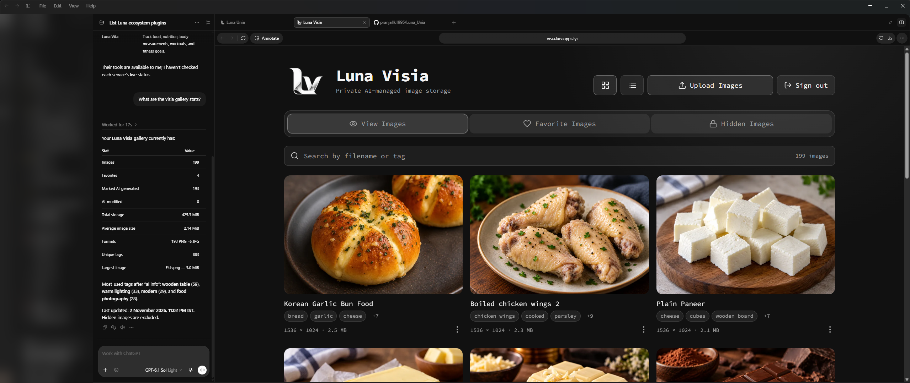
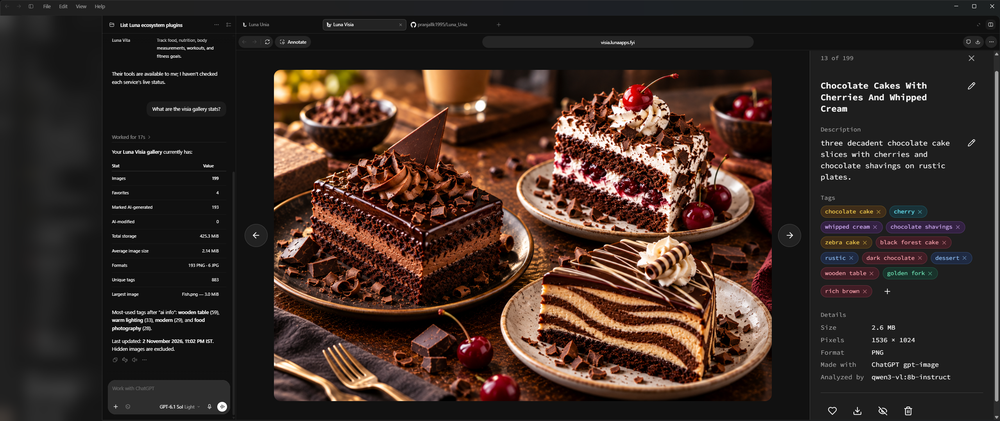

# Luna Visia


<p align="center">
  <a href="docs/assets/luna-visia-showcase.mp4"></a>
</p>

<p align="center"><em>From Google sign-in through Luna Unia to searching and browsing images in Luna Visia, then asking a chat assistant to find images, and to search by meaning with embeddings and hand back a ZIP, through its MCP tools. Select it for the sharper video.</em></p>

## Generate, Manipulate, Search and Store images of your choice using LLMs

> Luna Visia is a local-first and desktop-first image store and search.

Luna Visia is an AI-powered, private image library that runs locally. A local
Ollama vision model, served by [Luna Sentia](https://github.com/pranjallk1995/Luna_Sentia), analyzes every upload automatically, creates a concise caption and
searchable tags, and stores that metadata in PostgreSQL. FastMCP makes the indexed
collection available to AI assistants of your choice (ChatGPT here) for fast search and safe image-management
operations without repeatedly opening every original image.

> **Requires Luna Sentia, running and healthy:** Luna Visia keeps its data in Luna Sentia's PostgreSQL (`luna-sentia-db`) and joins Sentia's `luna_sentia_network`; it has no database of its own. Start [Luna Sentia](https://github.com/pranjallk1995/Luna_Sentia) first and wait until its `postgres` and `ollama` services report healthy, as described under [Start](#start). Sentia also serves the model: Visia uses `qwen3-vl:8b-instruct` by default, a download larger than 6 GB that needs an NVIDIA GPU with at least 8 GB of VRAM in Sentia's default configuration; see [Vision model](#vision-model) to choose another model.

<p align="center">
  
</p>

The web interface lets you upload, search, view, favorite, download, hide,
restore, and delete images, one at a time or as a selection. Image data, metadata, and AI models persist in Docker volumes,
while sign-in-gated hidden images stay separate from normal galleries and searches.

<p align="center">
  
</p>

An MCP-connected AI assistant can query Luna Visia's filenames, generated captions, and tags,
answer collection-level questions, and return matching filenames without visually
reprocessing every original image.

Luna Visia is also well suited to bulk image manipulation and editing workflows.
Its MCP tools let an AI assistant find and act on groups of images while keeping
the stored files and their searchable metadata synchronized.

The main gallery provides filename search, pagination, AI-generated captions and
tags, full-size viewing, downloads, and deletion controls. Persisted Favorites
provide a focused collection for images you return to often.

Hidden Images asks for your [hidden-items PIN](https://github.com/pranjallk1995/Luna_Sentia#hidden-items-pin) on top of the Google sign-in
and supports adding, viewing, downloading, restoring, searching, and deleting
images separately.

Connect Luna Visia's `/mcp` endpoint to the ChatGPT app as a custom MCP server.
Once connected, you can ask ChatGPT to search the vault, inspect image metadata,
display previews, download selected images, and manage the visible collection
through natural-language requests.

## Current features

### AI-assisted image ingestion

- Upload images through the web UI or MCP tools.
- Generate a concise caption and normalized searchable tags with the local Ollama vision model.
- Run the vision model and the embedded-provenance check as parallel branches of a LangGraph graph (`mcp/app/services/analysis_graph.py`) that then adds the `ai modified` and `ai info` system tags.
- Preserve the content hash, source size, analysis model, timestamps, and optional public URL in PostgreSQL.
- Replace image content and refresh its metadata as one coordinated operation.
- Backfill missing or stale metadata for files imported outside the normal upload flow.

### Visible image library

- Search filenames, AI captions, and tags without reopening original image files.
- Browse 3:2 thumbnails with twelve images per page and full-size viewing.
- Download individual images, or have an LLM package selected originals into a ZIP and return a short-lived download link.
- Rename images safely while keeping filenames, metadata, and generated URLs synchronized.
- Edit captions and tags without rerunning vision analysis.
- Select many images in the web UI (**Select**, then click, shift-click a range, or **Select all**, across pages and searches) to favorite, unfavorite, hide, restore, or delete them together, or to correct them together: add and remove tags, find and replace text in descriptions, or give them all one description. Images that could not be changed are reported and stay selected.
- Delete image files and their metadata together.

### Favorites and hidden images

- Maintain a persisted Favorites collection for visible images.
- Protect Hidden Images with the signed-in UI session and your [hidden-items PIN](https://github.com/pranjallk1995/Luna_Sentia#hidden-items-pin), which unlocks them until you leave the tab or stay idle for 10 minutes. While locked, hidden images' files and thumbnails are refused too.
- Authenticate the UI's Hidden Images backend requests with a private service credential.
- View, edit, download, restore, or permanently delete hidden images through authenticated routes.
- Exclude hidden images from public galleries, searches, previews, URLs, and MCP tools.

### Local AI and assistant access

- Run MCP/API and the web UI as one local Docker Compose stack, using the PostgreSQL, Ollama, and Adminer services from Luna Sentia.
- Expose searchable image operations to compatible assistants through Streamable HTTP MCP.
- Keep Ollama and PostgreSQL private to the shared Docker network while binding UI and MCP ports to localhost.
- Use an optional NVIDIA GPU for vision analysis (configured in Luna Sentia), with a slower CPU fallback. SigLIP 2 image embeddings run on the GPU only; without one, `backfill_metadata` adds them later.

## Models

| Part | Model | Where it runs | Before changing it |
| --- | --- | --- | --- |
| Captions and tags | `VISION_MODEL` (default `qwen3-vl:8b-instruct`), 16k context | Sentia's Ollama, on the GPU | Compare it on every stored image with [`model_evaluations/`](model_evaluations/README.md); afterwards `backfill_metadata` re-analyzes images made by another model |
| Meaning search | SigLIP 2 (`google/siglip2-base-patch16-224`, `EMBEDDING_MODEL` in `mcp/app/core/config.py`) | Here, on the GPU only, in its own process | Pinned in the image; after a change `backfill_metadata` re-embeds every image made by another model |

`VISION_MODEL` must be in Sentia's `SENTIA_MODELS`; Sentia's
[Changing a model](https://github.com/pranjallk1995/Luna_Sentia#changing-a-model) lists every check to run first.

## The model outside Ollama

Besides the models it calls through Ollama, Luna Visia runs one of its own, inside its
backend: SigLIP 2 (`google/siglip2-base-patch16-224`), which turns every image and every search into an embedding for meaning search. It runs on the GPU only, in its own process, which loads on the first image or search and exits after `GPU_MODEL_IDLE_SECONDS` (120) unused, so the GPU is fully free again for Luna Sentia's resident chat model.

Its calls never pass through [Luna Sentia's model monitor](https://github.com/pranjallk1995/Luna_Sentia#model-monitor), so the app counts them itself: whether the model is
loaded and on which device, its calls, failures, and busy time since the app started,
and the GPU memory this process holds (from torch, since WSL cannot split VRAM by
process). `GET /api/models` reports them, for the owner only, and the monitor's **Inside
the apps** card asks every ten seconds.

## Users and separate storage

Each person signs in with Google and has their own space in Luna Visia: the schema `u_<id>` in the `lunavisia` database, and the folder `u_<id>` in the `luna_visia_image_data` volume. It is created the first time they use the app. The owner adds, disables, and deletes people at Luna Sentia's `/admin`, and can hide this app from everyone else there; see [Users and separate storage](https://github.com/pranjallk1995/Luna_Sentia#users-and-separate-storage).

### Connecting an MCP client

Add `https://<your visia MCP host>/mcp` to your client, such as Claude or ChatGPT, as a custom connector using OAuth. The client signs you in with Google and shows an approval page; check the return address, then allow it. Its tools then act only on your data. A request without a valid token gets 401.

### Starter library

Everyone starts with the images the owner has chosen, as their own copy in their own gallery. They can rename or delete a copy without touching anyone else's. Copies take no extra disk space, because the files are hard links on one volume and every change to a stored image replaces its file rather than writing into it. Each copy has its own ID and public link.

- Hidden images and favorites are never included.
- New uploads are not included unless the owner chooses them, so they stay private.
- Each image is given once: a copy someone deleted does not come back, and a name they already use keeps their own image.
- Later changes to the owner's original do not reach existing copies, and taking an image out of the library does not remove copies people already have.

The owner chooses with the `set_starter_images` MCP tool. Everyone gets chosen images straight away, including people who joined earlier.

In the code, `mcp/app/core/tenancy.py` holds who the current request or job acts for, `mcp/app/data/tenants.py` creates and removes each person's schema, and `mcp/app/transport/luna_mcp.py` checks connector tokens and the private token on `/api/` routes. Code that does not say who it acts for raises `NoUserError` rather than reading anyone's data.

## Architecture

### Luna ecosystem


<!-- luna-models:start -->
**Which app uses which model.** All of them run on Luna Sentia, which keeps Socia's chat model on the GPU and lets the others visit; see its [Models](https://github.com/pranjallk1995/Luna_Sentia#models) and [Changing a model](https://github.com/pranjallk1995/Luna_Sentia#changing-a-model).

| Model | Served by | Used by | Before changing it |
| --- | --- | --- | --- |
| `qwen3-vl:8b-instruct` | Ollama | Lexia (`DOCUMENT_MODEL`), Visia (`VISION_MODEL`), Vibia (`CAPTION_MODEL`), Fiora (`OLLAMA_MODEL`), Socia's photo descriptions (`LUNASOCIA_VISION_MODEL`) | `model_checks/check_model.py`, then Lexia's, Visia's and Vibia's `model_evaluations/` |
| `huihui_ai/qwen3-abliterated:14b` (Qwen3 14B, uncensored) | Ollama, resident at `SENTIA_RESIDENT_CONTEXT` | Socia's chat (`LUNASOCIA_CHAT_MODEL`) | `model_checks/check_model.py --context 8192`, then Socia's `model_evaluations/` |
| `qwen3-embedding:0.6b` | Ollama | Lexia's semantic search (`EMBEDDING_MODEL`) | Re-embed with Lexia's `reindex_semantic_search` |
| Qwen-Image 2.1 Turbo | ComfyUI | Socia's pictures of Luna | A few pictures by hand |
| SigLIP 2 (`google/siglip2-base-patch16-224`) | Visia itself, GPU only | Visia's meaning search | Pinned in Visia's image; `backfill_metadata` re-embeds |
| CLAP (`laion/clap-htsat-unfused`) | Vibia itself, GPU or CPU | Vibia's listening and search | Pinned in Vibia's image; every track is heard again |
| Docling (layout, tables, OCR) | Lexia itself, GPU or CPU | Lexia's page reading | Pinned in Lexia's image |
| Whisper `large-v3-turbo`, Kokoro 82M | Socia itself, CPU | Socia's voice messages and Luna's voice (`LUNASOCIA_STT_MODEL`, `LUNASOCIA_TTS_VOICE`) | Listen to a few replies; downloaded on first use |
<!-- luna-models:end -->

Every Luna app but Luna Socia is a React UI plus a FastMCP service on Luna Sentia's
`luna_sentia_network`; Socia, the owner's chat with Luna, is one service with no MCP
server. Each app's data lives in Sentia's PostgreSQL, people sign in through Sentia's
`auth`, and model calls go through Sentia's model monitor, which times each one, samples
the GPU and keeps Socia's chat model resident, to its Ollama. Socia's pictures come from
Sentia's ComfyUI, which takes turns with Ollama on the GPU. Visia's SigLIP 2, Vibia's CLAP
and Lexia's Docling run inside those apps instead, each in a process that exits when idle.
Orange lines are Visia image URLs that other apps use: food images for Vita, room images
for Lumia, and cover art for Vibia. Grey dashed lines are planned: links into Fiora (tax
details from Lexia, transaction image and icon URLs from Visia). Luna Unia is the one home
for the other apps, on port 42069: it checks which Luna stacks are running and opens each
one with the shared sign-in. The purple line is the mood and beats of the track Vibia
plays, which Lumia's lights follow.

| Component | Technology | Purpose |
| --- | --- | --- |
| UI | React + TypeScript (Vite), served by a Starlette gateway | Upload, search, galleries, Favorites, downloads, bulk actions, and authenticated hidden-image workflows |
| HTTP and MCP | FastMCP + Starlette routes | Assistant tools plus UI-facing image, metadata, Favorites, and hidden-vault endpoints |
| Image service | Python + Pillow | Validated ingestion, previews, ZIP delivery, safe file operations, and metadata coordination |
| Vision | Ollama in Luna Sentia | Local caption and tag generation with `qwen3-vl:8b-instruct` by default |
| Image embeddings | SigLIP 2 (`google/siglip2-base-patch16-224`) in the MCP container, GPU only | 768-number embeddings for similarity ordering, other apps, and future search; not served by Ollama |
| Database | PostgreSQL 17 in Luna Sentia (`luna-sentia-db`) | Metadata, SigLIP embeddings (pgvector), full-text search indexes, Favorites, hidden state, configuration, and credential hashes |
| Storage | Docker volumes | Original images; the database and Ollama models live in Luna Sentia's volumes |
| Database UI | Adminer in Luna Sentia | Local inspection of every Luna app's database on `luna-sentia-db` |
| Network | `luna_sentia_network` (external) | Shared private network created by Luna Sentia; services use project-specific aliases |

The main service flow is:

```text
React UI (through its gateway) or MCP client
        -> Luna Visia MCP/API
        -> image volume + PostgreSQL metadata
        -> Luna Sentia Ollama (luna-sentia-ollama) when image content changes
        -> SigLIP 2 in the MCP container (GPU) when image content changes
```

The UI reads original images from `image_data` as read-only. All mutations go through the MCP/API service so file and database changes remain coordinated.

## Start

Start [Luna Sentia](https://github.com/pranjallk1995/Luna_Sentia) first and wait until it is healthy. Sentia runs
the PostgreSQL server that holds Visia's `lunavisia` database, serves the models,
and creates the shared `luna_sentia_network` every Luna app joins. Visia has no
database of its own: started before Sentia is healthy, it cannot reach its
data and keeps restarting until it can.

```sh
cd ../Luna_Sentia
docker compose up -d --wait postgres ollama adminer
docker compose run --rm postgres-init   # creates the lunavisia role and database
docker compose ps                       # postgres and ollama must show (healthy)
```

See [Is Sentia healthy?](https://github.com/pranjallk1995/Luna_Sentia#is-sentia-healthy) if they do not.

To start Sentia and every Luna app together, with or without Compose Watch, use
`../luna.sh start [--watch]`; see the
[Sentia README](https://github.com/pranjallk1995/Luna_Sentia#start-everything).

A fresh clone needs no `.env`: `luna.sh start` runs Visia with localhost defaults, where only Luna Sentia's owner may use it and the UI-to-backend token is `lunavisia-dev-token-for-localhost-only`. Set your own values before giving it a public (https) address; `luna.sh start` refuses a public app that still uses the default token.

To change them, create a private `.env`:

```dotenv
# Must equal LUNAVISIA_DB_PASSWORD in Luna_Sentia/.env
POSTGRES_PASSWORD=replace-with-a-private-database-password
VISION_MODEL=qwen3-vl:8b-instruct
LUNAVISIA_PUBLIC_BASE_URL=
LUNAVISIA_API_TOKEN=replace-with-a-random-value-of-at-least-32-characters
LUNAVISIA_ALLOWED_EMAILS=*
```

`LUNAVISIA_API_TOKEN` is a shared secret between the UI and the MCP server, not a key issued by any service. Generate your own random value of at least 32 characters:

```sh
openssl rand -hex 32
```

`LUNAVISIA_COMPANION_TOKEN` is optional. When it is set, Luna Vita and Luna Vibia can store generated images here, such as food images and cover art. They send it as a bearer token to `POST /api/companion/images`, with one source (`image_url`, `content_base64`, or a chat `file`) plus an optional `name` and `tags`. Visia stores and captions the image, or returns the copy it already has for identical bytes, and answers with its stable `public_url`. Use one random value, set the same in all three apps' `.env` files. Leave it empty to turn the route off.

`*` allows everyone with a Luna account; otherwise separate accounts with commas. `LUNAVISIA_PUBLIC_BASE_URL` is optional;
`UI_PUBLIC_URL` is the address of the web UI, which the `get_ui_link` tool gives out.
`MCP_PUBLIC_URL` is optional and defaults to `http://localhost:18000`; set it to your public HTTPS origin when the server is exposed (plain HTTP is accepted only for localhost).
leave it blank when stable public image URLs are not needed.

### Sign-in

Visia signs people in through Luna Sentia's single sign-on: one Google sign-in at
Sentia opens every Luna app, and **Sign out** in any app signs out of all of them.
Visia needs no Google client of its own. Set in `.env`:

- `LUNA_SSO_URL`: Sentia's public sign-on address (`SENTIA_AUTH_PUBLIC_URL` in
  Sentia's `.env`), for example `https://auth.lunaapps.fyi`.
- `LUNA_SSO_INTERNAL_URL`: `http://luna-sentia-auth:8000`, where Visia checks
  sessions over `luna_sentia_network`.
- `LUNAVISIA_ALLOWED_EMAILS`: who may use Visia among the people with a Luna account: blank
  (the default) for Sentia's owner only, `*` for everyone, or a comma-separated list. The owner always may. Checked after Sentia confirms who is signed in.

Sentia's auth service must be healthy before Visia can sign anyone in; see
[Single sign-on](https://github.com/pranjallk1995/Luna_Sentia#single-sign-on) for its setup.

Start Luna Visia:

```sh
docker compose up --build
```

Open:

- UI: <http://127.0.0.1:18501>
- Service health: <http://127.0.0.1:18000/health>
- Favicon and icons: <http://127.0.0.1:18000/favicon.ico> and `/icons/icon-{48,96,192,512}.png`; the 48 and 96 px icons are also embedded in the MCP `initialize` server info so connector clients such as Claude can show them.
- MCP endpoint: <http://127.0.0.1:18000/mcp> (clients sign in; see Connecting an MCP client)

The example keeps these development defaults:

| Setting | Default |
| --- | --- |
| Database | `lunavisia` |
| Username | `lunavisia` |
| Password | `lunavisia-dev` |
| Database host inside Docker | `luna-sentia-db` |

The API token and Google-account allowlist have no defaults and must be set in
`.env` before Compose starts the application.

Docker is not started automatically by repository setup or validation.

Luna Sentia pulls the vision model; make sure `VISION_MODEL` is listed in
Sentia's `SENTIA_MODELS`. Open Luna Visia at
<http://127.0.0.1:18501>. After signing in,
the Hidden Images tab asks for your hidden-items PIN, which you set once in Luna Sentia
at `/pin` for Visia, Lexia, and Vibia.

Check GPU use while analysis is active:

```sh
docker compose -f ../Luna_Sentia/docker-compose.yaml exec ollama ollama ps
nvidia-smi
```

If NVIDIA passthrough is unavailable, remove `gpus: all` from the Ollama service in Luna Sentia to use the CPU fallback. Captioning will still work but will be slower. Also remove `gpus: all` from Luna Visia's `mcp` service, or Docker refuses to start it; images are then stored without SigLIP embeddings until a GPU is back and `backfill_metadata` adds them.

## Vision model

The default model is `qwen3-vl:8b-instruct`, the model Lexia and Fiora also use, so
Ollama keeps one model loaded for all of them. Use the `-instruct` tag: plain
`qwen3-vl:8b` is the thinking variant, which reasons at length before every reply
and ignores the JSON format Visia asks for. Each image records the model that
analyzed it (`analysis_model`, shown as "Analyzed by" in the preview); after
changing the model, `backfill_metadata` re-analyzes every image made by another one.
To use a different Ollama vision model,
add it to `SENTIA_MODELS` in Luna Sentia's `.env`, restart Sentia so it pulls
the model, then set `VISION_MODEL` in Visia's `.env`. For example, use Llama 3.2
Vision 11B:

```dotenv
# Luna_Sentia/.env
SENTIA_MODELS=qwen3-vl:8b-instruct qwen3-embedding:0.6b llama3.2-vision:11b

# Luna_Visia/.env
VISION_MODEL=llama3.2-vision:11b
```

Visia reaches Ollama at `http://luna-sentia-ollama:11434` on the shared
`luna_sentia_network`; override it with `OLLAMA_URL` if needed. Ollama is never
published on a host port, and no API key or external image service is used.
Visia does not wait for the model at startup: uploads made before Sentia has
finished pulling it fail until the model is available.

### Before changing the model

Compare the new model with the current one on the whole gallery first:
[`model_evaluations/`](model_evaluations/README.md) captions every stored image with
both, without writing to the database, and scores how well each caption matches its
image in SigLIP 2's space, plus failures, tag counts, language and time. Run Luna
Sentia's `model_checks/check_model.py` on the model before that; the full list of
checks is in Sentia's [Changing a model](https://github.com/pranjallk1995/Luna_Sentia#changing-a-model).

## Codex MCP configuration (optional)

Add the following to the Codex `config.toml` in `.codex` directory in root:

```toml
[mcp_servers.lunavisia]
url = "https://visia-mcp.example.com/mcp"
enabled = true
required = false
startup_timeout_sec = 20
tool_timeout_sec = 60
```

A task that was already open before a new tool was added may need to be reloaded or reopened for tool discovery.

## Database UI

Use [Adminer in Luna Sentia](https://github.com/pranjallk1995/Luna_Sentia#database-ui) at
<http://127.0.0.1:19080>. It reaches every Luna database over the shared private
`luna_sentia_network`; the database port itself remains unavailable from the host. Use:

- System: `PostgreSQL`
- Server: `luna-sentia-db` (the same server holds every Luna app's database)
- Username: `lunavisia`
- Password: your `POSTGRES_PASSWORD`, or `lunavisia-dev` when unset
- Database: `lunavisia`

## MCP tools

Luna Visia exposes these tools to connected MCP clients:

### Web UI

- `get_ui_link` - the link to open this app's web UI, to give the user; they sign in with their Luna account.

### Browse and retrieve

- `list_images` - list visible images newest first, one page at a time (`limit`, default 50; follow `next_offset`), as compact summaries with each image's `public_url`. `include_preview=true` adds a numbered contact sheet of the first 20 images on the page.
- `view_image` - show a preview of one visible image plus its caption and `public_url`.
- `fetch_images` - display up to 20 visible images in chat as one preview or a numbered contact sheet (a near-square grid at most 1536 px wide, labeled with original filenames, transparency shown on a checkerboard), plus a text key with each tile's number, exact name, caption, and `public_url`; names that are no longer available are listed under `unavailable` instead of failing the request. Or with `delivery="zip"` package up to 200 originals (2 GiB) and return a `download_url` on the public base URL that expires after 24 hours and survives service restarts (archives live on the `luna_visia_download_data` volume, capped at 10 GiB with oldest evicted first). The ZIP is never embedded in the tool result, which keeps large downloads within MCP message limits.
- `get_image_url` - return the stored public URL for one visible image when a base URL is configured.

### Add and modify images

- `upload_image` - add an image from exactly one source: `file` (a chat attachment; declared through ChatGPT's `openai/fileParams`), `image_url` (public HTTPS or data URL), or `content_base64` (small images only; wrapped, unpadded, URL-safe, and data-URL Base64 are accepted). `name` is optional: the extension is corrected to the detected format, taken names get a `_2` suffix, and an exact duplicate of a visible image returns `status: "duplicate"` instead of a second copy.
- `create_upload_link` - return a single-use HTTPS link (15 minutes) that accepts a raw or multipart (`file`) POST. Use it from agents with a shell or code sandbox, since LLMs cannot emit megabytes of Base64.
- `add_image` - add a small image from Base64 (same handling as `upload_image`).
- `modify_image` - replace a visible image from `file`, `image_url`, or `content_base64` and refresh its metadata.
- `rename_image` - safely rename a visible image file and its metadata without re-running vision analysis; its immutable image ID and public URL remain unchanged.
- `rename_images` - rename up to 100 visible images in one call, applied in order so chained renames work. Each rename follows the `rename_image` rules and succeeds or fails on its own; results list `renamed` and `failed` (with each image's error).
- `remove_image` - delete a visible image and its metadata.
- `remove_images` - delete up to 100 visible images at once; per-image errors are reported under `failed` instead of stopping the batch.

### Metadata, search, and collections

- `get_image_metadata` - return everything known about one visible image: the stored record (caption, tags, favorite flag, size, SHA-256, analysis model, timestamps, `public_url`) plus what the file embeds: format, dimensions, readable EXIF (camera, lens, exposure, software, dates, GPS in decimal degrees), PNG text chunks, XMP `DigitalSourceType`/`CreatorTool`, and a summary of its C2PA content-credentials manifest (claim generator, actions, software agent, IPTC digital source type). `ai_generated` and `ai_signals` explain whether embedded provenance marks the image as made by generative AI. C2PA signatures are reported, not verified, and missing provenance does not prove an image is not AI-generated, since re-saving or screenshots strip it.
- `get_gallery_stats` - library statistics computed from stored metadata without opening files: `total_images`, `favorite_count`, `ai_generated_count` (images tagged `ai info`), `ai_modified_count` (images tagged `ai modified`), total and average size (bytes and human-readable), the largest image, a count per file format, `unique_tag_count`, the `top_tags` most used tags (default 10), and the oldest and newest `updated_at`. Hidden images are not counted.
- `list_image_metadata` - bulk metadata for searching and classifying many images with an LLM. It pages newest first like `list_images` (`limit`, default 50; follow `next_offset`) or takes an exact `names` batch, listing missing or hidden names under `unavailable`. `detail="summary"` (up to 100 per call) returns each image's name, caption, tags, favorite flag, size, `updated_at`, and `public_url` plus an `embedded` object with format, dimensions, `ai_generated`, `ai_signals`, generator, camera, lens, capture time, software, and GPS when present. `detail="full"` (up to 20 per call) returns the complete `get_image_metadata` output for each image.
- `update_image_metadata` - update a visible image's caption and/or add or remove tags without replacing the image or re-running vision analysis. Tags must be lowercase: a tag with capital letters is rejected and nothing is changed.
- `update_images_metadata` - apply caption and tag changes to up to 100 visible images in one call, for example LLM classification results from `list_image_metadata`. Each entry (`name`, optional `caption`, `add_tags`, `remove_tags`) is applied independently and reported under `updated` or `failed`; a capitalized tag anywhere rejects the whole batch with nothing changed.
- App tags - every image another Luna app uses carries that app's tag: `luna vibia` (track covers, with `cover art`), `luna vita` (food images, with `food`), and `luna lumia` (room and light pictures). The apps add them through `POST /api/companion/images/tags` with `LUNAVISIA_COMPANION_TOKEN`; an image at the tag limit drops its last ordinary tags, never `ai info`, `ai modified`, or an app tag. Find them with `search_images(tags=[...])` and edit many with `update_images_metadata`.
- `set_starter_images` - owner only: choose the images everyone starts with; hidden images and favorites are never included.
- `set_favorite_images` - add or remove visible images from Favorites using exact filenames.
- `search_images` - search filenames, captions, and tags without opening original images; results include `public_url` and `next_offset`, and `include_preview=true` adds a contact sheet of the first 20 results. `exclude_tags` leaves out images carrying those tags and can be the only filter (`exclude_tags=["ai info"]` finds every image not marked as AI-generated). Tag filters must be lowercase too.
- `semantic_search_images` - find images by meaning: embeds the query with SigLIP 2 and ranks visible images by the cosine similarity of their image embeddings, so "italian food" also finds garlic bread, which no filename, caption, or tag calls Italian. Results are best first with a `similarity` score and no cutoff, so the LLM reads the captions and keeps the real matches, then can pass them to `fetch_images` with `delivery="zip"`. Images without an embedding are skipped until `backfill_metadata` adds one, and it needs the GPU.
- `sort_images` - arrange the visible gallery for showcasing: `order="similarity"` saves an order where neighbors look alike, by the cosine similarity of their SigLIP image embeddings, starting from `start` or the newest image. The web gallery, Favorites, and `list_images` follow it. Images added or restored afterwards are slotted in between their most similar neighbors; an occasional full sort tidies the drift. `order="newest"` clears it.
- `backfill_metadata` - generate missing or stale metadata for imported files, add the `ai info` tag to already-indexed AI-generated images, and embed images that lack a SigLIP embedding.

Every image also gets a SigLIP 2 image embedding (`google/siglip2-base-patch16-224`, 768 numbers) when it is analyzed, stored in the pgvector `embedding` column with an HNSW index for other apps. `semantic_search_images` compares query embeddings against them. Embeddings are made on the GPU only (fp16, about 0.75 GB): without a CUDA device, or if the GPU stays out of memory, the image is stored without one and `backfill_metadata` adds it later. The model is baked into the image, so nothing is downloaded at runtime.

Images whose embedded metadata says generative AI made them get the `ai info` tag automatically on upload or replacement. The signals are a C2PA or XMP IPTC digital source type of `trainedAlgorithmicMedia` or `compositeWithTrainedAlgorithmicMedia` (as in ChatGPT/gpt-image output), a known generator in EXIF `Software` or XMP `CreatorTool`, or diffusion parameters in PNG text chunks. Search for them with `search_images(tags=["ai info"])`. The tag is enforced on every edit path (MCP tools, batch updates, and the web UI, for visible and hidden images): removing `ai info` from an image whose metadata marks it as AI-generated is rejected, and editing such an image that lacks the tag adds it back. On other images the tag can be added or removed freely.

### URL configuration

- `set_public_base_url` - update the optional persisted public base URL and regenerate stored image URLs.

Hidden Images routes are UI-only. Like every `/api/` route except public, download,
and upload links, they need the private `LUNAVISIA_API_TOKEN` and name the person in
`X-Luna-User`. Hidden images are not exposed as MCP tools.

The web UI's bulk actions send at most 100 images per request to `POST /api/images/delete`, `/api/images/metadata`, `/api/hidden/delete`, and `/api/hidden/images/metadata`. Each image is applied on its own: results come back under `removed` or `updated`, and per-image errors under `failed`. Favorites, hiding, and restoring reuse `POST /api/favorites` and `/api/hidden/hide` and `/restore`.

## Metadata and search

Every add, upload, or replacement is analyzed before it is committed. The generated caption, normalized tags, content hash, model name, and timestamps are stored in PostgreSQL. Deletion removes the file and its metadata consistently.

The MCP tool:

```text
search_images(
  query: str = "",
  tags: list[str] | None = None,
  match_all_tags: bool = False,
  limit: int = 50,
  offset: int = 0
)
```

returns `{query, normalized_query, count, results[]}`, where each result contains `name`, `caption`, `tags`, and `updated_at`. Search reads the metadata index and never opens original images. PostgreSQL uses a generated weighted `tsvector` with a GIN index for English caption/tag full-text search and a second GIN index for tag array queries.

Run or resume an idempotent metadata backfill through the MCP `backfill_metadata` tool after importing images outside the normal ingestion flow.

## Data model

### `image_metadata`

Stores one row per image: immutable UUID, filename, byte size, SHA-256 content hash, AI caption, normalized tag array, analysis model, creation and update timestamps, hidden state, favorite state, and optional public URL. A weighted PostgreSQL `tsvector` indexes filenames, captions, and tags, with additional indexes for the immutable ID, tags, hashes, hidden images, and Favorites.

The filename remains the storage key matching the image in the persistent `image_data` volume, while external references use the immutable UUID. Public URLs therefore survive filename changes. Legacy filename URLs remain readable for compatibility while that filename still exists. File mutations and metadata updates are coordinated by `ImageVaultService` so a failed operation does not intentionally leave half-applied state.

### `vault_security`

Legacy hidden-vault credential data may remain in upgraded databases for
compatibility, but the sign-in-gated Hidden Images UI no longer reads or updates it.

### `vault_config`

Stores the singleton optional public base URL used to generate immutable-ID image URLs. Updating the origin refreshes each URL without changing its image ID or filename.

The idempotent schema in `mcp/app/data/database.py` runs when the MCP service starts and applies additive upgrades for existing installations.

## Project structure

The backend follows the same layered package layout across all three Luna apps:

- `mcp/app/core/` - configuration, validation models, and domain primitives.
- `mcp/app/data/` - database setup, repositories, and storage adapters.
- `mcp/app/services/` - transport-independent use cases and orchestration.
- `mcp/app/integrations/` - external services, devices, and peer-app clients.
- `mcp/app/transport/` - FastMCP tools, HTTP routes, authentication, and branding.
- `mcp/app/main.py` - the small composition root that wires the layers together.

Luna Vita, Luna Lumia, and Luna Visia share this layout:

```text
.
├── docker-compose.yaml     # services, shared-network membership, and Compose Watch rules
├── README.md
├── UI_STYLE_GUIDE.md       # shared Luna visual reference
├── docs/assets/            # README screenshots
├── mcp/                    # FastMCP server: MCP tools plus UI-facing HTTP routes
│   ├── Dockerfile
│   ├── requirements.txt
│   ├── app/                # main.py composition root, config, database, models,
│   │                       # repositories, services, mcp_tools, http_routes,
│   │                       # and the app's own domain modules
│   ├── scripts/            # one-off maintenance scripts, when needed
│   └── tests/              # python -m unittest discover -s tests
└── ui/                     # Web interface
    ├── Dockerfile          # builds the React app, then the gateway image
    ├── requirements.txt
    ├── gateway.py          # serves the app; checks sign-in; fronts the backend
    ├── images.py           # vault file facts and cached WebP thumbnails
    ├── sso.py              # single sign-on through Luna Sentia
    ├── config.py           # environment-backed settings
    ├── assets/             # source logos
    ├── tests/              # gateway tests: python -m unittest discover -s tests
    └── web/                # the React app (TypeScript, Vite)
        ├── public/         # logo and favicon
        └── src/            # App, api, uploads, lib, styles, components/
```

The browser runs the interface, so a click, a search, or a page change needs no
server round trip. All data goes through the gateway, which checks the shared
Luna session and allowlist first and holds the backend's API token, so the token
never reaches the browser. Only the backend routes the UI uses are forwarded.

## Development workflow

Use Docker Compose Watch to keep the running development stack aligned with local
source changes:

```sh
docker compose up --build --watch
```

Gateway changes are synchronized into `/workspace/ui` and restart the gateway;
changes under `ui/web/` rebuild the image. For hot reload while working on the
browser app, run `npm install && npm run dev` in `ui/web/`. Its tests run with
`npm test`, and `npm run build` type-checks it. MCP source changes are synchronized into `/workspace/mcp`
and restart only the MCP service so newly registered tools become available from
the server. Changes to either service's `requirements.txt` or `Dockerfile`
rebuild that service. Python caches, test caches, and MCP tests are ignored by the
runtime watcher. Named image and database volumes are never watched or
synchronized.

Compose Watch is a foreground process and must remain running for source sync.
If it exits or its terminal closes, restart it with `docker compose watch`.

If the stack is already running, attach the watcher with `docker compose watch`.
An already-open Codex task may still need to be reopened after an MCP tool-schema
change so the client refreshes its discovered tool catalog.

### UI modules

- `ui/gateway.py` - `UIGateway`: serves the built app, reports the session and settings at `/auth/session`, serves thumbnails and files, and forwards an allowlist of backend routes with the private API token.
- `ui/images.py` - `ImageFiles`: pairs backend metadata with vault files (size, dimensions, order) and encodes cached WebP thumbnails.
- `ui/sso.py` - single sign-on through Luna Sentia: checks the shared `luna_sso` cookie with Sentia, and applies the allowlist.
- `ui/config.py` - `UIConfig` and `SSOConfig`: gateway settings, plus the page size, tag limits, and upload types the browser app reads from `/auth/session`.
- `ui/web/src/App.tsx` - sign-in pages, header, and section navigation.
- `ui/web/src/api.ts` - the gateway's routes and the React Query hooks; changes apply on screen first and roll back if the server refuses them.
- `ui/web/src/uploads.ts` - the upload queue, which keeps running when the dialog is closed.
- `ui/web/src/lib.ts` - pure helpers for names, sizes, search, paging, selections, and bulk edits.
- `ui/web/src/components/` - `Gallery`, `ImageCard`, `BulkBar`, `BulkEditDialog`, `PreviewDialog`, `UploadDialog`, `ConfirmDialog`, `Dialog`, `Pager`, `SearchBox`, and `Toasts`.
- `ui/web/src/styles.css` - the Luna visual system.
- `ui/requirements.txt` - Python dependencies used by the UI container.
- `ui/Dockerfile` - builds the UI container image.

### MCP modules

- `mcp/app/main.py` - `LunaVisiaApplication` composition root: builds the database, repositories, services, and server, then runs it.
- `mcp/app/transport/mcp_tools.py` - `VisiaMCPTools`, the public MCP image-management tools (hidden images are never reachable here).
- `mcp/app/transport/http_routes.py` - `VisiaHTTPRoutes`, the REST routes used by the UI and public image links, with uniform error translation and service-token checks for Hidden Images.
- `mcp/app/services/application.py` - use cases: `VisibleImageService` and `HiddenImageService` (sharing `ImageCollectionService`), `ImageIndexer` (analysis and backfill), `SearchService`, `PublicURLService`, and the `VisiaService` facade.
- `mcp/app/data/repositories.py` - PostgreSQL persistence for image metadata, public URLs, and legacy hidden-vault credentials.
- `mcp/app/data/database.py` - `Database` connection handling and the idempotent schema.
- `mcp/app/data/storage.py` - `ImageStorage`, safe vault paths plus write, rename, and delete operations that roll back if metadata persistence fails.
- `mcp/app/services/media.py` - upload byte validation, chat previews and contact sheets, and `ImageArchive` (uncompressed ZIPs with original filenames).
- `mcp/app/services/downloads.py` - `DownloadStore`, short-lived ZIP archives behind unguessable `/api/downloads/{token}` links.
- `mcp/app/integrations/remote.py` - `ImageSourceResolver` for chat file references, Base64, data URLs, and SSRF-guarded HTTPS upload sources.
- `mcp/app/services/uploads.py` - `UploadLinkStore`, single-use upload tickets behind `/api/uploads/{token}`.
- `mcp/app/core/models.py` - `ImageAnalysis`, `ImageRecord`, `MetadataChange`, and `MetadataRules` (caption, tag, and search-text normalization).
- `mcp/app/integrations/vision.py` - `OllamaVisionAnalyzer`, local vision-model requests.
- `mcp/app/transport/branding.py` - `ServerBranding`, the bundled icon set in `mcp/app/assets/` (favicon plus PNG sizes) exposed as MCP server-info icons and HTTP icon routes.
- `mcp/app/transport/auth.py` - constant-time bearer authentication for signed-in UI requests to Hidden Images routes.
- `mcp/app/transport/security.py` - legacy password/PIN authentication retained only for database compatibility and migration history.
- `mcp/app/core/config.py` - reads and validates MCP settings, including database, image, Ollama, and vision-model configuration.
- `mcp/app/__init__.py` - marks the MCP application directory as a Python package.
- `mcp/tests/` - automated tests for the services, MCP tools, HTTP routes, media helpers, and security safeguards, using in-memory fakes from `fakes.py`.
- `mcp/requirements.txt` - Python dependencies used by the MCP container.
- `mcp/Dockerfile` - builds the MCP container image.

The dark theme is in `ui/web/src/styles.css`. Stop the stack with `docker compose down`; named volumes remain.
